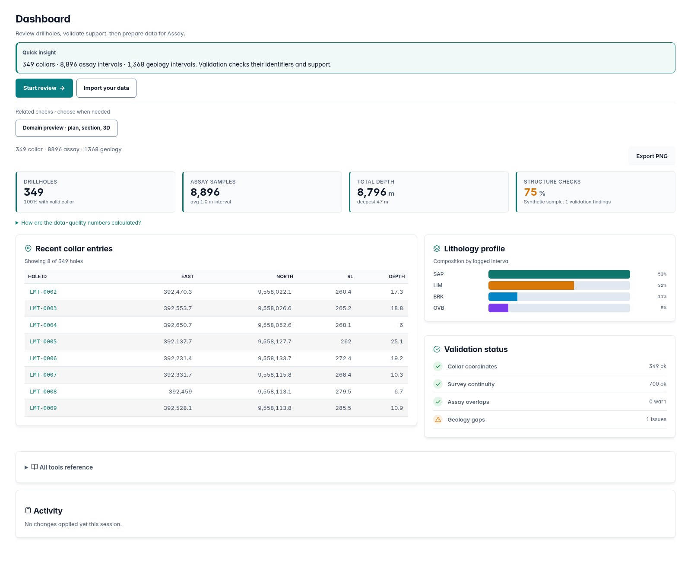

# Orebit GeoSuite

[](https://github.com/ghoziankarami/geosuite/actions/workflows/ci.yml)
[](https://github.com/ghoziankarami/geosuite/releases/latest)
[](LICENSE)

Drillhole data to a screening block model, in the browser or on Windows.
Free and open source. No account, licence key or paid tier. English and Bahasa Indonesia.

| Module | What it does |
| --- | --- |
| **Core** | Import collar/survey/assay/geology CSVs, validate and correct them, desurvey, merge. **Domain** builds a closed geological solid from two contact surfaces or from rings drawn on parallel sections, checks it and exports DXF/OBJ. |
| **Assay** | Statistics, top-cut, domain populations, composites that stop at domain boundaries. |
| **Resource** | 3D variograms, block model clipped to the domain solid, ordinary kriging / IDW / NN, cross-validation, grade-tonnage, PDF report. |

**Bahasa Indonesia:** GeoSuite mengolah data bor sampai model blok screening:
validasi dan desurvey (Core), solid domain geologi, statistik dan komposit (Assay),
variogram dan estimasi (Resource). Gratis, tanpa akun, bisa offline.



## Install / Pasang

| Platform | How |
| --- | --- |
| **Any browser** | Open [geosuite.orebit.id/Core.html](https://geosuite.orebit.id/Core.html). Nothing to install. |
| **Windows 10/11** | Download `Orebit-Core.exe`, `Orebit-Assay.exe` and `Orebit-Resource.exe` from the [latest release](https://github.com/ghoziankarami/geosuite/releases/latest) into **one folder**. See [Windows executables](docs/INSTALLATION.md#windows-executables). |
| **macOS, Linux, ChromeOS** | Open Core in Chrome/Edge and choose **Install app**; in Safari use **File → Add to Dock**. Runs offline after all three modules are opened once. |
| **From source** | Node.js 18+ and Python 3.9+, then [run from source](#run-from-source). |

The Windows executables are unsigned. Compare them with `SHA256SUMS.txt` from the same release.
**Code → Download ZIP** is the source code, not the executables.

## First run

The app opens with a synthetic nickel laterite sample (349 collars). It contains
a few deliberate data errors so you can practise the correction workflow.

1. **Core:** Validation → fix the listed records → Desurvey → Merge → Domain → Export.
2. **Continue in Assay:** check distributions, choose top-cut or no cap, make composites.
3. **Continue in Resource:** fit a variogram, build the block model, estimate, export the PDF.

Follow the [10-minute quickstart](docs/vignettes/en/00-quickstart.md)
([Bahasa Indonesia](docs/vignettes/00-quickstart.md)). For real public data, use the
[Thalanga tutorial](docs/vignettes/en/01-thalanga-vms.md). Before importing your own files,
read [input format and units](docs/DATA-FORMAT.md). A missing value is never treated as zero.

More: [workflow guide](docs/WORKFLOW.md) · [methodology and limitations](docs/METHODOLOGY.md) ·
[installation and troubleshooting](docs/INSTALLATION.md)

## Run from source

```bash
git clone https://github.com/ghoziankarami/geosuite.git
cd geosuite
npm run dev
```

Open <http://127.0.0.1:8767/Core.html>. Assay and Resource are `/Assay.html` and
`/Resource.html` on the same address. There is no `npm install` step: libraries are
bundled in `vendor/`. `npm run doctor` checks prerequisites; `npm run dev -- --port 8768`
picks another port. The same commands work in Windows PowerShell.

Serve the generated `dist/`. Files in `phases/` contain build markers and do not run directly.

## Releases

- Each version is a [GitHub release](https://github.com/ghoziankarami/geosuite/releases)
  with the three Windows executables, a web ZIP for local hosting, `SHA256SUMS.txt` and notes on what changed.
- Versions follow `MAJOR.MINOR.PATCH`. The web app at geosuite.orebit.id runs the latest release.
- Check your version on the Core dashboard. Updating the web app does not update an
  executable or a source checkout; download the new release or pull and rebuild.

## Contribute

```bash
npm run build
npm test
```

`npm test` does not open a browser. Changes to calculations or the UI also need the
browser checks in [docs/DEVELOPMENT.md](docs/DEVELOPMENT.md), with independently calculated
expected values. Read [CONTRIBUTING.md](CONTRIBUTING.md) before opening a pull request.
Use synthetic or public data only.

| Path | Contents |
| --- | --- |
| `phases/` | Module markup and logic (Core, Assay, Resource) |
| `src/shared/` | Shared calculation, geometry, import, report and UI code |
| `src/locales/`, `src/assets/`, `src/pwa/` | Translations, samples, fonts, offline support |
| `build/`, `desktop/` | Web build and Windows packaging |
| `tests/` | Numerical, import, browser and offline tests |
| `docs/` | Tutorials, input format, methodology, contributor guide |
| `vendor/` | Bundled libraries with their own licences |

This repository receives exports from the maintainer's development repository.
Accepted public pull requests are carried back before the next export, so you can
clone, build, test and contribute here without any other access.

[Report a bug](https://github.com/ghoziankarami/geosuite/issues/new?template=bug-report.md) ·
[Report wrong numbers](https://github.com/ghoziankarami/geosuite/issues/new?template=wrong-numbers.md) ·
[Tester feedback](https://github.com/ghoziankarami/geosuite/issues/new?template=tester-feedback.md) ·
[Discussions](https://github.com/ghoziankarami/geosuite/discussions) ·
[Security](SECURITY.md)

## Limits

Results are screening estimates, not Mineral Resources or Reserves under KCMI or JORC.
A domain solid is an interpretation: check it against logs and sections. Density in
the sample is an assumption. Reporting still needs geology, QA/QC, density, metallurgy,
economics and Competent Person review. Optional Google Drive, basemaps and update
checks contact external services; see the [privacy policy](https://geosuite.orebit.id/privacy/).

## Licence

[GPL-3.0-only](LICENSE). Sample data and bundled libraries keep their own licences;
see [THIRD_PARTY_NOTICES.md](THIRD_PARTY_NOTICES.md). Cite with [CITATION.cff](CITATION.cff).
Contact: <contact@orebit.id>.
